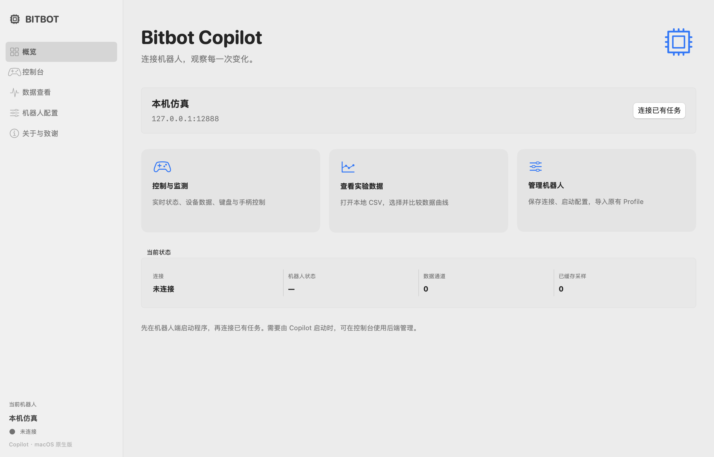
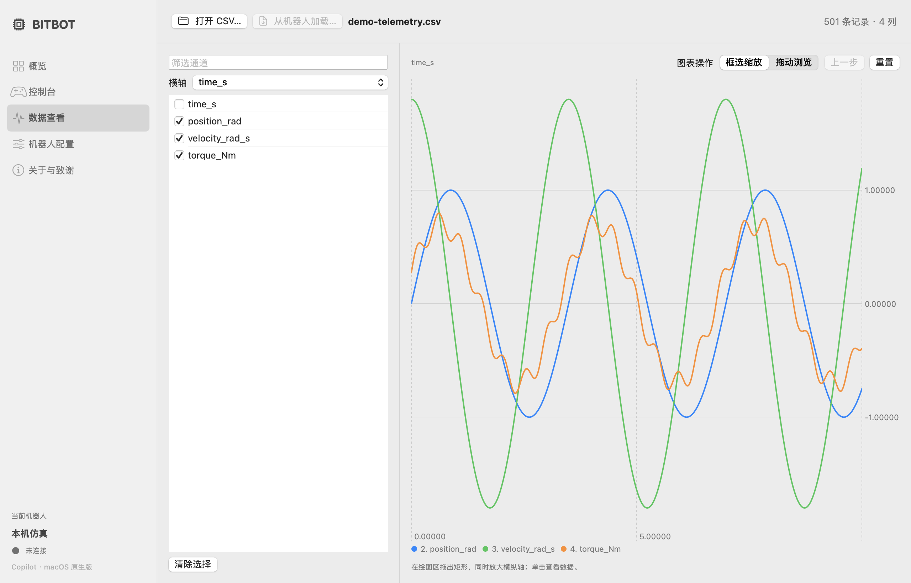

# Bitbot Copilot · macOS

用于机器人控制、实时状态监测和 CSV 数据分析的 macOS 原生客户端，使用 SwiftUI、AppKit、Swift Charts 和 Game Controller。



## 功能

- **控制与监测**：HTTP/WebSocket 连接机器人，默认以分组表格展示内核、设备和用户数据，可切换实时曲线。
- **键盘与手柄**：连接后直接使用已注册按键，支持原生手柄和虚拟摇杆；大号按键面板显示按下、释放和最近发送事件。
- **数据分析**：本地或远端 CSV、通道筛选、自选横轴、框选缩放、连续放大、缩放历史和拖动平移。
- **机器人配置**：多个 Profile、旧版 INI 导入、本地/SSH 后端启动与自动初始化。
- **数据导出**：缓存最近 1200 个实时采样（默认约 120 秒），可导出 CSV。



文档图片由当前 SwiftUI/AppKit 视图离线渲染。CSV 图使用仓库自带的[示例数据](doc/examples/demo-telemetry.csv)，由数学函数生成，不来自真实机器人。

## 构建与运行

需要 macOS 14+、Xcode 15+ 和 Swift 5.9+。在项目根目录执行：

```bash
bash macOS/build.sh
open "macOS/output/Bitbot Copilot.app"
```

默认生成当前 Mac 架构的 Release 应用，采用本地 ad-hoc 签名。面向其他电脑分发时需自行处理 Developer ID 签名与公证。

```bash
# Apple Silicon + Intel 通用应用
BITBOT_UNIVERSAL=1 bash macOS/build.sh

# 调试构建
BITBOT_CONFIGURATION=debug bash macOS/build.sh

# 直接运行；也可在 Xcode 中打开 Package.swift
swift run BitbotCopilot
```

`BITBOT_BUILD_ROOT` 和 `BITBOT_OUTPUT_DIR` 可设置构建缓存与应用输出目录。也保留可选的原生 CMake 构建入口：

```bash
cmake -S . -B build
cmake --build build
open "build/bin/Bitbot Copilot.app"
```

## 连接机器人

1. 在「机器人配置」中添加机器人，设置控制服务地址，默认 `127.0.0.1:12888`。
2. 在机器人或仿真端启动 Bitbot 服务，再从首页选择「连接已有任务」，或在控制台填写地址后连接。
3. 控制台默认显示表格：设备占行，传感器字段占列；选择「曲线」后可勾选数据通道绘图。
4. 连接完成后可直接使用机器人注册的键盘按键。在输入框内正常打字，点击「结束文本编辑」可返回控制。切离应用或控制台时释放按键，返回后自动恢复。
5. 「输入设备」可查看手柄状态并使用虚拟摇杆。「后端管理」可启动配置的本地/远端进程，并在连接后执行自动初始化。

配置保存在 `~/Library/Application Support/BitbotCopilot/profiles.json`。切换配置会断开当前连接，无需重启应用。

### 导入旧版配置

在「机器人配置」点击「导入旧版配置…」，选择原来的 `profile/*.ini`。支持前端地址、后端路径、SSH 地址和自动初始化动作，导入不修改原文件。旧版头像、密码、缓存路径和界面设置不导入。

## CSV 数据查看

打开或拖入 CSV 文件，勾选通道并选择横轴。可先使用[示例 CSV](doc/examples/demo-telemetry.csv)体验：

- **框选缩放**：在绘图区拖出矩形，同时放大横纵轴；支持反向拖拽和连续放大。
- **上一步 / 重置**：返回前一次框选范围，或恢复全图。
- **拖动浏览**：平移当前视图；单击图中位置查看原始数据读数。

支持 UTF-8 BOM、CRLF、引号、科学计数法和无标题的数值文件。无效行会报错。历史曲线按当前可见区域进行极值抽样，光标读数来自原始数据。切换横轴、数据通道或重新加载文件会清除旧缩放范围。

### 远端数据与后端管理

SSH/SFTP 使用 macOS 自带的 OpenSSH，通过系统密钥或 `ssh-agent` 认证。请先在终端连接目标主机，确认主机指纹并配置免交互认证：

```bash
ssh -p 22 robot@192.168.1.5
```

应用使用 `BatchMode=yes`，不保存密码，也不显示交互式密码提示。系统 SSH config、known_hosts 和 agent 继续生效，端口和用户名取自 Profile。

配置远端数据目录后，在「数据查看」选择「从机器人加载…」，通过 SFTP 浏览目录并下载 CSV。文件在加载后从临时目录删除；远端文件名应不含换行符。

「后端管理」按配置的工作目录启动可执行文件或脚本，等待服务就绪后再连接前端。「停止进程」终止本次本地进程或 SSH 会话；远端程序是否随 SSH 会话退出取决于其自身实现。自动初始化逐步发送按下/释放事件，等待目标状态或指定时长后继续；取消时完成当前按键释放。

## 开发与测试

```bash
swift test

# 使用真实原生视图重新生成文档图片
bash macOS/Tools/render-docs.sh
```

测试覆盖协议编码、64 位数值精度、CSV 解析、旧版配置导入、配置持久化、进程输出、输入焦点、切回应用恢复输入，以及框选缩放和平移坐标转换。HTTP/WebSocket 集成测试使用本地 Python 模拟机器人，需要 `/usr/bin/python3` 和监听回环端口的权限。

机器人协议入口：HTTP `/monitor/stateslist`、`/setting/control/get`、`/monitor/headers`，WebSocket `/console`。客户端每 100 毫秒请求实时数据，沿用原版嵌套 JSON、二进制控制帧、浮点命令位编码与摇杆 32768 缩放。连接超时或超过 5 秒未收到实时数据时会关闭连接；重连会取消旧连接任务。

```text
Package.swift                    Swift 包入口
CMakeLists.txt                   可选的 macOS 构建入口
macOS/Sources/BitbotCore/         协议、配置、CSV、进程与 SFTP
macOS/Sources/BitbotCopilot/      原生窗口、页面和资源
macOS/Tests/                     单元测试与本地模拟机器人
macOS/Tools/                    文档图片渲染工具
macOS/build.sh                  应用打包脚本
macOS/Info.plist                应用元数据
doc/                           界面截图与示例数据
```

本仓库仅维护 macOS 原生版本。图片/PDF 图表导出、多文件叠加、手柄震动和应用自动更新尚未实现。实际机器人、手柄与 SSH 环境仍需硬件联调。

## 版权与致谢

Copyright © 2026 Siyuan Wang. 项目使用 GNU GPL v3，详见 [COPYRIGHT](COPYRIGHT) 与 [LICENSE](LICENSE)。

感谢原版 Bitbot Copilot 作者 **zishun zhou**，详见 [ACKNOWLEDGEMENTS.md](ACKNOWLEDGEMENTS.md)。程序的「关于与致谢」页面提供离线版权、致谢和许可证。
